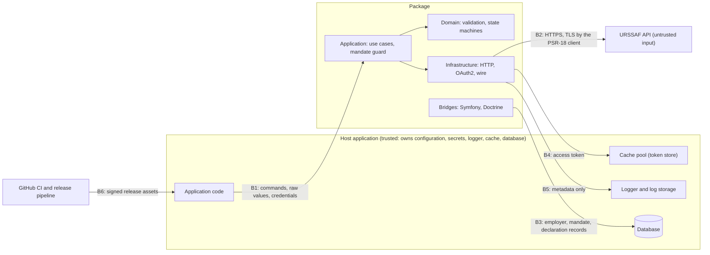

# Security assurance case

This document argues why the security requirements of `thebeardedbear/urssaf-tierce-declaration-cesu` are met. It is
grounded in a review of the code at the commit named in the [security review](security-review-2026-11.md): each claim
points to the file that implements it, and the document states its limits. The package is a library, so part of the
security of a deployment belongs to the host application (see [Assumptions on the host](#7-assumptions-on-the-host-application)).

Reporting a vulnerability: [SECURITY.md](../../SECURITY.md).

## 1. What is protected

The package lets a platform act as third-party declarant for private employers with the URSSAF "API Tierce Déclaration
CESU": it registers employers (010), checks employers and employees (020, 021), notifies and cancels the employer's
mandate (030, 031), estimates contributions (040), declares salaries (050, standard and Cesu+, with the withholding at
source) and activates Cesu+ (060) and the immediate tax credit advance, AICI (070). It authenticates with OAuth2 client
credentials (scope `tiersdecl.cesu`).

| Asset | Where it lives | Sensitivity |
|---|---|---|
| OAuth2 `client_id` / `client_secret` of each tenant | Host configuration or `CredentialsProvider`; in memory in `Application\Port\Credentials` | Secret |
| Access token | `TokenStore` (PSR-6 / PSR-16 cache pool), in memory during a call | Secret, short lived |
| Employer data sent at registration (010): identity, birth place, contact details, address, IBAN / BIC, account holder | `Domain\Employer\*`, in memory, sent to URSSAF; **never persisted** (ADR 0007) | Personal data (GDPR), financial |
| NIR and identity of employees (021, 050) | `Domain\Employee\*`, in memory, sent to URSSAF; **never persisted** (ADR 0007) | Personal data (GDPR), highly sensitive |
| Local employer account: Cesu number, birth date, registration stage, external reference | `urssaf_cesu_employer_accounts` (Doctrine bridge) or host repository | Personal data (GDPR) |
| Mandates of the employer (state, timeline, presence checks) | `urssaf_cesu_mandates`, `urssaf_cesu_active_mandates` | Authorisation record: gives the platform the right to declare |
| Declaration records and results: employment kind, period, employee Cesu number when known, gross and net taxable salary, salary transfer, contributions, withholding tax, debits, URSSAF error descriptions | `urssaf_cesu_declaration_records` | Personal data and integrity critical (social contributions, tax) |
| Integration events (outbox) | `urssaf_cesu_outbox` or in memory | Technical identifiers, states and codes only; no personal data |
| Source code and releases | GitHub repository, Packagist, release assets | Integrity critical (supply chain) |

## 2. Security requirements

| ID | Requirement |
|---|---|
| SR1 | Credentials and tokens are never persisted by the package, never logged, never present in exception messages, and masked when dumped. |
| SR2 | Personal data (identity, birth data, NIR, IBAN, BIC, address, e-mail, phone, salary amounts) is never logged by the package, never present in exception messages, minimised in storage (no IBAN, BIC, NIR, name, address, e-mail or phone is persisted) and erasable (GDPR). The employer Cesu number is an identifier, not personal data by itself: it appears in the request path and in some exception contexts (finding SR-14). |
| SR3 | The declarations and amounts sent to URSSAF are what the host asked for: validated, exactly represented (no float drift), declared only under an employer mandate, and not duplicated by retries or concurrent workers. |
| SR4 | Everything received from URSSAF is untrusted: parsed strictly, never executed or deserialised into arbitrary objects, and a malformed response fails closed. |
| SR5 | Requests are authenticated and sent to the intended URSSAF host; one tenant can neither use nor see another tenant's credentials, tokens or records. |
| SR6 | A failure of URSSAF or of the network degrades gracefully: bounded retries, an explicit "outcome unknown" state for a write that may have reached URSSAF (never resent automatically), no data loss, no unbounded loop. |
| SR7 | The code and the release artefacts come from the maintainers' reviewed and tested commits and can be verified by consumers. |

## 3. Threat model

| Actor | Capability considered | Main threats |
|---|---|---|
| Network attacker | Observes or tampers with traffic between the host and URSSAF | Eavesdropping on tokens, NIR or employer data, response tampering, downgrade |
| Malicious or compromised URSSAF endpoint (or a proxy configured as such) | Returns arbitrary bodies, statuses and sizes | Injection through response fields, deserialisation, resource exhaustion, secrets in error text, forged "declared" answer |
| Host application bug or misconfiguration | Controls configuration, logger, cache, database, listeners | Secrets in clear configuration, `http://` base URI, shared cache, verbose logs, no retention policy, skipped mandate check |
| Other tenant of a multi-tenant host | Uses the same host application | Cross-tenant access to employers, mandates, declarations, tokens or credentials |
| Hostile user-supplied data | Names, addresses, NIR, IBAN, salary lines reach the package through the host | Malformed values reaching URSSAF or the database; a doubled or altered salary declaration |
| Concurrent workers, crashes, retries | Several processes declare or reconcile at the same time; a worker dies mid-call | Double declaration of the same salary, lost outcome, erased data while a call is in flight |
| Malicious contributor, poisoned dependency, abused CI token | Pull request, dependency update, workflow permissions | Backdoor in the package, secret exfiltration from CI, tampered release |

Out of scope: compromise of the host server or the database server itself, and the security of the URSSAF platform
(see [SECURITY.md](../../SECURITY.md#scope)).

## 4. Trust boundaries

| Boundary | What crosses | Control in the package |
|---|---|---|
| B1 host to package | Commands and raw values | Value objects validate at construction (`src/Domain/**`: anchored regexes with `/D`, length and range limits, calendar-date and half-day rules); drafts report every violation; credentials only through `CredentialsProvider` |
| B2 package to URSSAF | HTTPS requests with a bearer token; untrusted responses | TLS and certificate verification are delegated to the PSR-18 client; strict JSON decoding and typed mapping (`Infrastructure/Urssaf/Wire`) |
| B3 package to database | Employer account, mandates, declaration records, outbox | Doctrine named parameters, tenant-scoped queries, no column for IBAN, BIC, NIR, names, address, e-mail or phone (the eleven mapping files list every column; `DoctrineMappingTest` asserts the absence of such columns), birth date in its own DBAL type that the host can replace to encrypt, GDPR erasure (`ForgetEmployer`) |
| B4 package to cache | Access token | Hashed cache key, item expires with the token, a malformed item is a cache miss |
| B5 package to logs | Technical metadata | Fixed set of fields: operation number, method, path (constant or with the employer Cesu number), status, duration, request id, exception class, and the fixed reason of an unreadable answer. The query string (employee lookup, NIR) is never logged |
| B6 pipeline to consumers | Releases | Pinned actions, least-privilege tokens, SLSA provenance, checksums |

Inside the package, Deptrac enforces the layers that separate these zones (`deptrac.yaml`).

## 5. Secure design principles

Saltzer and Schroeder principles mapped to the code.

| Principle | How it is applied | Where |
|---|---|---|
| Economy of mechanism | No third-party runtime code: `require` lists only PSR interfaces and PHP extensions (`json`, `mbstring`). The HTTP client, cache, clock and logger come from the host. The JSON encoder is a small own class that refuses floats. | `composer.json`, `Infrastructure/Urssaf/Wire/JsonEncoder.php` |
| Fail-safe defaults | `environment` is mandatory (no implicit production). The simulated gateway cannot be combined with `environment: production`. The default logger is a `NullLogger`. A malformed cached token is a cache miss. Unknown environments are rejected. A declaration needs an active mandate by default (`requireLocalMandate`), and erasure refuses a call in flight, an unknown outcome or an active mandate by default. | `Bridge/Symfony/DependencyInjection/BundleConfiguration.php`, `ConfigurationRules.php`, `Infrastructure/TokenStore/CachedAccessToken.php`, `Application/Policy/WorkflowPolicy.php`, `Application/Service/MandateGuard.php` |
| Complete mediation | Every URSSAF call goes through `JsonApiClient::send()` (rate limiter, bearer token, request id, status mapping). Value objects have private constructors, so every instance went through validation. Every declaration goes through `MandateGuard` before it is sent. | `Infrastructure/Urssaf/Http/JsonApiClient.php`, `src/Domain/**`, `Application/Command/DeclareSalaryHandler.php` |
| Open design | Open source, documented protocol mapping, public quality thresholds, architecture decision records. Nothing relies on secrecy of the code. | `README.md`, `docs/`, `docs/adr/`, `CONTRIBUTING.md` |
| Separation of privilege | Strict layers: Domain depends on nothing, Application on Domain and Contract, Infrastructure and bridges on the layers below. Integration events are separate scalar classes. Sending a declaration needs both a recorded `pending` record and an atomic claim. | `deptrac.yaml`, `src/Contract/Event`, `DeclarationRecordRepository::claimForSubmission()` |
| Least privilege | Credentials fetched per tenant on demand; a single OAuth2 scope (`tiersdecl.cesu`); CI workflows default to `contents: read` and elevate per job. | `Application/Port/CredentialsProvider.php`, `Infrastructure/Urssaf/UrssafEndpoints.php`, `.github/workflows/*.yml` |
| Least common mechanism | Token cache key is `urssaf_cesu.` + `sha256(environment, base URI, client id)`; locks per operation and scope; repository queries filter on tenant id. | `Infrastructure/Urssaf/Http/OAuth2TokenProvider.php`, `Bridge/Symfony/Lock/OperationLocks.php`, `Bridge/Doctrine/Repository/*` |
| Psychological acceptability | The secure path is the default path: secrets through `%env()%`, one factory to build the gateway, a `urssaf:cesu:check` installation diagnostic, a GDPR guide with an encryption example. | `docs/symfony.md`, `docs/doctrine.md`, `Bridge/Symfony/Diagnostic/*` |
| Defence in depth | Secrets are masked in `__debugInfo()`, marked `#[SensitiveParameter]`, not serialisable, not logged, absent from exception messages. Personal data value objects (NIR, IBAN, BIC, names, e-mail, birth data) are masked in dumps and have no `__toString()`. Sensitive data is also not stored (ADR 0007). | `Application/Port/Credentials.php`, `AccessToken.php`, `Domain/Employee/Nir.php`, `Domain/Employer/**` |
| Fail securely | HTTP errors become typed exceptions carrying the status and URSSAF error codes. An unexpected status or body raises `UnexpectedUrssafResponse` instead of being interpreted. Exactly one replay after a 401 and no other automatic retry in the client. A write that may have reached URSSAF (010, 050, 060, 070: transport error, any 5xx but 512, unreadable 2xx) becomes `OutcomeUnknown` and is never resent. | `Infrastructure/Urssaf/Http/JsonApiClient.php`, `Infrastructure/Urssaf/Exception/UnexpectedUrssafResponse.php`, `Application/Port/Urssaf/OutcomeUnknown.php`, `Application/Port/Operation.php` |
| Integrity by construction | Amounts are integer cents (`Money`, at most 15 integer digits), half-days have one decimal, both encoded as exact decimal literals (`JsonDecimal`); floats are refused by the encoder. A declaration is idempotent per `(tenant, external reference)`: the same reference with another content is refused, an atomic claim moves `pending` to `submitting` for one worker only, and `outcome_unknown` is settled by an operator (`ResolveDeclarationOutcome`) instead of blindly resent. | `Domain/Shared/Money.php`, `Domain/Shared/HalfDays.php`, `Infrastructure/Urssaf/Wire/MoneyEncoding.php`, `Application/Command/DeclareSalaryHandler.php`, `Bridge/Doctrine/Repository/DoctrineDeclarationRecordRepository.php` |

## 6. Common implementation weaknesses and how they are countered

| Weakness (OWASP Top 10 2021 / CWE) | Countermeasure | Where, verified by |
|---|---|---|
| SQL injection (A03, CWE-89) | DQL and DBAL with named parameters. The only interpolated identifiers are the outbox table name read from Doctrine metadata, constant entity class names and fixed DQL fragments, never request data. | `Bridge/Doctrine/Repository/*`; PHPStan Doctrine extension, review |
| HTTP, header and form injection (CWE-93, CWE-113) | Query and token body built with `http_build_query(..., PHP_QUERY_RFC3986)`; paths are constants or built with `rawurlencode()` from a validated Cesu number; the user agent and header names are validated (visible ASCII, no line break); header values come from configuration or generated ids. | `JsonApiClient::buildRequest()`, `OAuth2TokenProvider::fetch()`, `Wire/ApiPaths.php`, `ApiConfiguration.php`, `HttpHeader.php` |
| JSON injection (CWE-116) | Every key and string goes through `json_encode` with `JSON_THROW_ON_ERROR`; only null, bool, int, string, arrays, `JsonDecimal` and `JsonObject` are accepted. | `Wire/JsonEncoder.php` |
| Sensitive data exposure (A02, CWE-200, CWE-532) | Logs hold operation, method, path, status, duration, request id and exception class (plus the fixed reason of an unreadable answer); query strings, bodies and tokens are never logged. Exception messages hold codes, statuses and field names, not raw values. Debug output is masked. IBAN, BIC and NIR are never stored. | `JsonApiClient`, `OAuth2TokenProvider`, `Application/Port/Credentials.php`, `Domain/Exception/InvalidValue.php`, `DoctrineMappingTest`; unit tests |
| Cleartext transmission, improper certificate validation (CWE-319, CWE-295) | Default base URIs are `https://`. The package never disables verification (no `verify_peer`, `CURLOPT_*` or stream-context option in `src`). The default Symfony client has a timeout (`http_timeout`, 15 s). The scheme of an overridden base URI is not enforced (finding SR-01). | `Infrastructure/Urssaf/Environment.php`, `ApiConfiguration.php`, `GatewayRegistrar.php` |
| Insecure deserialisation (A08, CWE-502) | Responses are decoded with `json_decode` into arrays, never `unserialize`. A cached token must have the exact array shape and types. The outbox uses `unserialize` with an `allowed_classes` list of the ten scalar event classes, on data the package wrote itself (finding SR-03). `Credentials` refuses serialisation. | `Wire/JsonDecoder.php`, `TokenStore/CachedAccessToken.php`, `Contract/Event/IntegrationEventCodec.php` |
| Improper input validation (CWE-20) | Anchored regexes with the `D` modifier in `src/Domain` (no trailing-newline match; three other patterns lack it, finding SR-15), character allow-lists, bounded lengths, postal and municipality codes, dates, phone, e-mail, Cesu number; strict decimal parser; response fields read through typed accessors. The NIR, IBAN and BIC have only a shape check: URSSAF validates their content (finding SR-12). | `src/Domain/**`, `Wire/Payload.php`, `Wire/MoneyEncoding.php` |
| Numeric errors (CWE-190, CWE-681) | Integer cents with a digit limit; no float on the encoding path; the amounts of a response (JSON numbers) are rounded to cents and rejected when negative, too large or not finite, and are only stored, never sent back. | `Domain/Shared/Money.php`, `Decimal.php`, `HalfDays.php`, `Wire/MoneyEncoding.php` |
| Race conditions, double processing (CWE-362) | Atomic `UPDATE ... WHERE state = pending` claim before any call (`claimForSubmission`), optimistic lock `version`, unique key table for the single active mandate per employer, unique external reference per tenant, non-blocking locks in the Symfony bridge, post-checks and rollback in `ForgetEmployer`. | `Bridge/Doctrine/Repository/*`, `Bridge/Doctrine/Entity/ActiveMandate.php`, `Bridge/Symfony/Lock/OperationLocks.php`, `Application/Command/ForgetEmployerHandler.php` |
| Hard-coded credentials (CWE-798) | None in the repository; secrets come from the host; fixtures use fictitious values; GitHub secret scanning with push protection is enabled. | `CONTRIBUTING.md`, repository settings |
| Weak randomness (CWE-330, CWE-338) | `random_bytes()` through `SecureRandomBytes`, UUID v4 layout. No `rand`, `mt_rand` or `uniqid` in `src`. Integration event ids are deterministic on purpose (hash of the fact, for deduplication) and are not security tokens. | `Infrastructure/Id/*`, `Application/Service/IntegrationEventFacts.php` |
| Authentication failures (A07) | Client-credentials flow; the token is renewed `token_safety_margin` seconds early (default 60); a 401 invalidates the cached token and triggers one replay; 400, 401, 403 on the token endpoint, and 403 and 512 on a call, raise `UrssafAuthenticationFailed`; records that failed on credentials go to `invalid_credentials` and are requeued explicitly (`RequeueAfterInvalidCredentials`). | `OAuth2TokenProvider`, `JsonApiClient::send()`, `Application/Command/RequeueAfterInvalidCredentialsHandler.php` |
| Broken access control, tenant isolation (A01, CWE-639) | Credentials resolved per tenant; repository queries scoped by `tenantId`; locks per operation and scope; the mandate is checked before every declaration. Lookups by aggregate id (`get(id)`) are not tenant-filtered: the ids are random UUIDs handed out by the package itself (finding SR-13). | `Bridge/Doctrine/Repository/*`, `Application/Port/CredentialsProvider.php`, `Application/Service/MandateGuard.php` |
| Resource exhaustion (CWE-400, CWE-770) | Client timeout, in-process sliding-window rate limiter (default 2500 calls per hour and tenant), page size cap in `WorkflowPolicy`, JSON depth limit, one replay at most, non-blocking locks. The response body size is not capped by the package (finding SR-02). | `UrssafHttpGateway`, `SlidingWindowRateLimiter`, `JsonDecoder`, `WorkflowPolicy` |
| Vulnerable and outdated components (A06) | No third-party runtime code. Development tooling: `composer audit` in CI and `make composer-checks`, `roave/security-advisories`, Dependabot weekly (Composer and GitHub Actions), committed `composer.lock`. | `composer.json`, `.github/dependabot.yml`, `.github/workflows/ci.yml` |
| Supply chain, integrity failures (A08) | Actions pinned to a commit SHA; `contents: read` by default, elevated per job; `persist-credentials: false` on the CodeQL, Scorecard, release and DCO checkouts; no `pull_request_target`; workflow inputs passed through `env`, not interpolated in scripts; CodeQL for workflows; OpenSSF Scorecard; releases carry `SHA256SUMS` and a SLSA provenance attestation; `main` is protected by a ruleset (pull request and status checks required, no force push, no deletion, no bypass actor). | `.github/workflows/*.yml`, `.github/actions/setup/action.yml`, `SECURITY.md` |
| Logging and monitoring failures (A09) | Metadata-only logs on the host logger; a failure reporter for post-commit failures; `urssaf:cesu:status` monitoring and `urssaf:cesu:check` diagnostics; integration events for every state change. | `Infrastructure/Logging/PsrLoggerFailureReporter.php`, `Bridge/Symfony/Command/*`, `docs/workflow.md` |
| SSRF (A10, CWE-918) | The path is a constant or built from a validated Cesu number; only the base URI is variable and it is operator configuration, never derived from URSSAF responses or user input. | `Infrastructure/Urssaf/ApiConfiguration.php`, `Wire/ApiPaths.php`, `UrssafEndpoints.php` |
| Insecure design (A04) | The threat model above, layers enforced by tooling, explicit state machines for employer stages, mandates and declaration records, unknown outcomes never resent, erasure refused while a call is in flight. | `deptrac.yaml`, `Domain/Declaration/DeclarationState.php`, `Domain/Mandate/MandateState.php`, `docs/adr/0003-retry-and-unknown-outcome.md`, `docs/adr/0015-employer-erasure.md` |

### Tools that verify these countermeasures

| Tool | What it checks | Where it runs |
|---|---|---|
| PHPStan level max (strict, deprecation, Doctrine, Symfony, PHPUnit rules) | Type safety, unsafe patterns | CI `phpstan`, `make phpstan` |
| Mago lint and analyze (`--minimum-fail-level=note`) | Static analysis | CI `mago`, `make mago` |
| Deptrac | Layer boundaries inside the package | CI `deptrac`, `make deptrac` |
| PHPUnit with 100% line, method and class coverage, and at least 96% branch coverage | Behaviour including failure paths | CI `coverage`, `coverage-branches`, `bin/check-coverage`, `bin/check-branch-coverage` |
| Infection with 100% MSI and covered MSI | The tests detect behaviour changes | CI `infection`, `make infection` |
| SonarQube Cloud (when enabled by the repository variable) | Vulnerabilities, security hotspots | CI `sonarcloud` |
| `composer audit`, `roave/security-advisories`, Dependabot | Known vulnerable dependencies | CI `composer-checks`, Dependabot |
| CodeQL on the GitHub Actions workflows | Workflow injection, excessive permissions | `.github/workflows/codeql.yml` |
| OpenSSF Scorecard | Supply-chain practices | `.github/workflows/scorecard.yml` |
| SLSA provenance attestation and `SHA256SUMS` | Provenance of release archives | `.github/workflows/release.yml` |
| GitHub secret scanning with push protection | Committed secrets | Repository setting |

## 7. Assumptions on the host application

The assurance above holds if the host application:

1. keeps `client_secret` in a secret store or environment variable (a literal in committed configuration ends up in
   the compiled container) and restricts who can read it;
2. provides a PSR-18 client that verifies TLS certificates, with safe redirect behaviour, and does not override the
   base URI with a non-HTTPS URL outside tests;
3. uses a token cache pool private to the application: the access token is stored there in clear for its lifetime;
4. protects the database (access control, encryption at rest, optionally column encryption of the employer birth date
   and of the declaration results through a custom DBAL type as described in
   [doctrine.md](../doctrine.md#personal-data-gdpr)), bounds the retention of backups and applies a retention and
   erasure policy to personal data, using `ForgetEmployer` (ADR 0015) and the `urssaf.cesu.employer.forgotten` event
   to erase its own copies;
5. does not log request or response bodies at its own HTTP-client level, and does not put personal data in the
   messages of exceptions raised by its own listeners and sinks;
6. keeps the mandate check on (`requireLocalMandate`, the default) unless it verifies the mandate itself, and settles
   the `outcome_unknown` declarations (`ResolveDeclarationOutcome`) instead of resending them;
7. cancels the mandate at URSSAF (`CancelMandate`) when it erases an employer: the erasure only removes the local copy,
   URSSAF keeps its own data.

## 8. Residual risks

The open items are tracked in the [security review](security-review-2026-11.md#findings) (SR-01 to SR-15). None is a
vulnerability in the default configuration; they are hardening opportunities and assumptions on the host.

## 9. Keeping the case valid

The case is revisited when a change touches a trust boundary: a new outbound call, a new persisted field holding
personal data, a new logging statement, a new dependency, a new workflow permission. Pull requests run the full
quality gate (`make ci`); the review document records the date and commit of the last human review.
