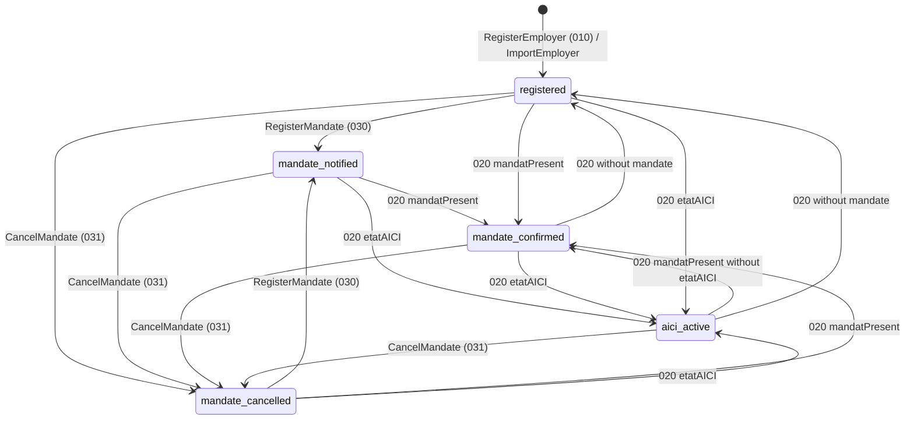
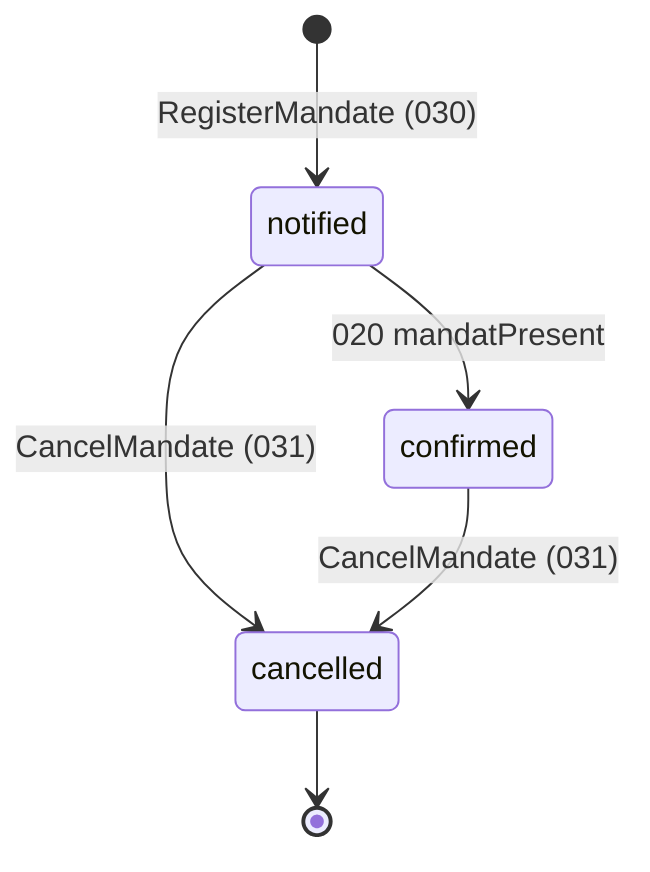
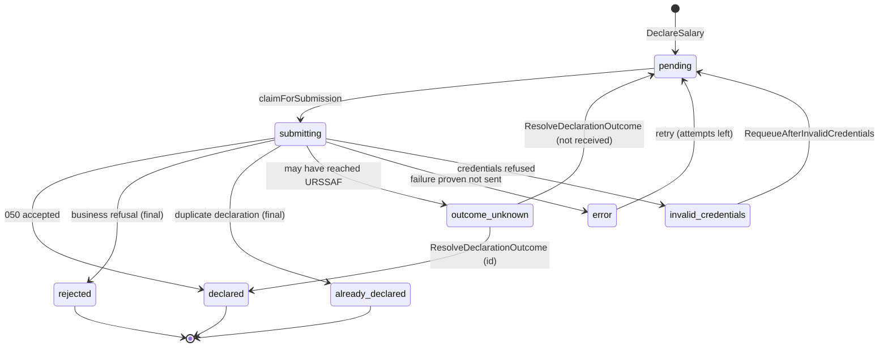

# Workflow

Three aggregates carry the workflow, all local to the package (URSSAF exposes no status for a declaration and only the
020 snapshot for an employer, [ADR 0006](adr/0006-local-lifecycles.md)): `EmployerAccount` (stage:
`Domain\Employer\EmployerStage`), `Mandate` (state: `Domain\Mandate\MandateState`) and `DeclarationRecord` (state:
`Domain\Declaration\DeclarationState`). Every transition is explicit; an invalid one throws
`Domain\Exception\InvalidStateTransition`. Aggregates record domain events (`releaseEvents()`), which `UnitOfWork`
publishes after the transaction commit. Every state change goes through `UnitOfWork::run()`; no URSSAF call is made
inside a transaction.

## Employer



Stages follow the answers of the API and never block a call. The Cesu+ state belongs to an employer / employee pair
(020 `etatCesuPlus`), so it is not an employer stage: the snapshot keeps it with the employee it was read for.

| Use case | Method | Effect |
|---|---|---|
| `RegisterEmployer` | 010 | Synchronous. Bank details are never stored ([ADR 0007](adr/0007-personal-data.md)). An external reference already tracked is refused without any call (`EmployerAlreadyTracked`). Nothing is stored when the call fails: an unknown outcome is checked by an operator, then `ImportEmployer`. |
| `ImportEmployer` | none | Tracks an existing Cesu employer. Idempotent for the same external reference and employer. Run `SyncEmployerStatus` afterwards. |
| `RegisterMandate` | 030 | Requires a tracked employer. An active local mandate is returned without a call. |
| `CancelMandate` | 031 | Requires an active local mandate (`MandateRequired` otherwise, no call). |
| `SyncEmployerStatus` / `SyncEmployerStatuses` / `SyncAllEmployerStatuses` | 020 | Refresh the account and its active mandate. Batches use the employer-only form. A refused employer (`UrssafRequestRejected`) is reported `failed` and the run goes on; invalid credentials and retryable failures stop it. |
| `ActivateCesuPlus` | 060 | Mandate guard first. Never resent, nothing stored. |
| `ActivateAici` | 070 | Nothing stored. The `aici_active` stage comes from the next 020 synchronisation. |
| `VerifyEmployer`, `VerifyEmployee`, `EstimateContributions` | 020, 021, 040 | Pure queries: nothing is written. |

## Mandate



Re-notifying after a cancellation creates a new mandate. At most one mandate per `(tenant, employer)` is active.
A 020 answer that reports a mandate unknown locally creates none (it would publish a false `mandate.notified`).

### Mandate guard

`DeclareSalary` (050) and `ActivateCesuPlus` (060) are refused locally (`MandateRequired`, no URSSAF call) unless the
employer has a non-cancelled local mandate, or the package never handled a mandate of this employer **and** the tracked
account is `mandate_confirmed` or `aici_active` (mandated outside the package, [ADR 0009](adr/0009-guards-and-opt-outs.md)).
Opt out per command with `skipMandateCheck: true`, or globally with `WorkflowPolicy::requireLocalMandate = false`.

## Declaration



`DeclareSalary` validates the draft (`ValidationFailed`, every violation at once), applies the local refusals (AF
declarations, mandate guard) **before any record or claim**, records the declaration, claims it atomically, sends it
(050) outside any transaction and applies the outcome in a new one:

| Outcome of 050 | Transition | Returned (`DeclarationSubmission`) |
|---|---|---|
| Accepted | `declared` with the result (`idDeclaration`, amounts) | `declared` |
| 5xx / transport error / unreadable 2xx | `outcome_unknown` (never resent) | `outcome_unknown` |
| Duplicate declaration (`ERR_METIER`) | `already_declared` (final) | `already_declared` |
| Any other business refusal | `rejected` (final, errors kept) | `rejected` |
| Credentials refused | `invalid_credentials` | `invalid_credentials` |
| 429 / token failure / local rate limit (provably not sent) | `error`, then `pending` while attempts remain | `RetryableUrssafFailure` thrown after the commit; `exhausted` returned once the attempts are used |
| Another package exception (not processed, e.g. a wrong base URI) | `error`, then `pending` while attempts remain | rethrown unchanged after the commit |
| Any other `Throwable` (bug, foreign gateway) | `outcome_unknown` (conservative) | rethrown unchanged after the commit |

The record never holds the payload ([ADR 0007](adr/0007-personal-data.md)): retrying is the host calling `DeclareSalary`
again with the same external reference and declaration.

## Idempotency

`DeclareSalary` is idempotent per tenant and external reference, with a content fingerprint that excludes personal data
(`hasSameContentAs`). When a record already exists for the reference:

| Existing state | Same content | Different content |
|---|---|---|
| `pending` | guard, then sent | `DeclarationAlreadyRecorded` |
| `submitting` | `not_claimed`, no call | `DeclarationAlreadyRecorded` |
| `declared`, `already_declared`, `outcome_unknown`, `invalid_credentials` | `replayed`, no call | `DeclarationAlreadyRecorded` |
| `error`, attempts left (only after the policy maximum was raised) | guard, retried, sent | `DeclarationAlreadyRecorded` |
| `error`, exhausted | `exhausted`, no call | `DeclarationAlreadyRecorded` |
| `rejected` | superseded: deleted and recorded again (new id), whatever the content | superseded likewise |

A rejected record is superseded because URSSAF answered 400 and recorded nothing ([ADR 0006](adr/0006-local-lifecycles.md)).
An exhausted `error` record has no domain exit: use a new external reference, or raise `maxSubmissionAttempts`.

Submission claims first (atomic `pending` to `submitting`); a record that is not pending is reported `not_claimed`, so
concurrent workers never send a record twice. Unique constraints: employers `(tenant, numero_cesu)` and
`(tenant, external reference)`, one active mandate per `(tenant, employer)`, declarations `(tenant, external reference)`
and `(tenant, idDeclaration)`.

## Retry and unknown outcomes

[ADR 0003](adr/0003-retry-and-unknown-outcome.md): CESU has no idempotency key, no GET for a declaration and no way to
find an employer from its registration data, so nothing can be reconciled automatically.

- Safe to retry (`RetryableException`): 020, 021, 040, 030 and 031 (assumed idempotent), the token call and a 429 on
  every operation.
- Never resent automatically: 010, 050, 060, 070. A transport error or a 5xx throws `OutcomeUnknown`.
- Stale submissions (`submitting` for at least `staleSubmissionAfter`, `PT15M` by default):
  `ReconcileStaleDeclarations` moves them to `outcome_unknown` (reason `stale_submission`, outcome `manual_review`)
  without calling URSSAF. An operator checks on cesu.urssaf.fr, then `ResolveDeclarationOutcome::asDeclared()` (with the
  `idDeclaration`) or `asNotReceived()` (back to `pending`, then the host calls `DeclareSalary` again).
- Attempts are counted (each `pending` to `submitting`). After `maxSubmissionAttempts` (5 by default) a failure is no
  longer requeued: the record stays in `error` (`exhausted`).
- `invalid_credentials` returns a result, not an exception. After fixing the credentials,
  `RequeueAfterInvalidCredentials` moves the records back to `pending`; repeat while the count reaches the limit, then
  call `DeclareSalary` again for each.
- Race: a very slow `DeclareSalary` racing `ReconcileStaleDeclarations` on the same record loses: its outcome
  transaction is refused with `declaration_record.concurrent_modification` (Doctrine optimistic lock, see
  [doctrine.md](doctrine.md#identity-and-concurrency)) and the record stays `outcome_unknown` (reason `stale_submission`)
  for the operator, who finds the `idDeclaration` on cesu.urssaf.fr. The in-memory repositories have no such check
  (`get()` returns a clone, so the last writer wins). With the default 15 minutes it needs a stuck process.

## Events, outbox pattern and safety crons

Domain events are published by `UnitOfWork` **after** the package transaction commits, in the order they were recorded.
Consequences to design for:

- **Nested transaction.** When a handler runs inside a transaction of your application, the events are published when
  it returns, *before* your outer transaction commits. Call the handlers outside your own transaction, or use the
  outbox.
- **Publisher failure.** A listener that throws after the commit must not undo the work: the failure is handed to the
  `FailureReporter` and the handler returns normally. An event whose listener failed is lost for that listener.
- **Outbox (recommended for anything that must not be lost).** Do not perform side effects in a domain event listener:
  give the `UnitOfWork` an `Outbox`, which writes the public integration events in the transaction of the state change
  and relays them at least once, in order per record. See [integration-events.md](integration-events.md).
- **Safety crons.** Make the workflow converge on its own, and keep these jobs running (they are idempotent and cheap
  when there is nothing to do): `RelayOutbox` (every minute), `PurgeOutbox` (daily), `ReconcileStaleDeclarations`
  (every 15 minutes), `SyncAllEmployerStatuses` (as often as your quota allows) and, after fixing credentials,
  `RequeueAfterInvalidCredentials`.
  With the Symfony bundle each one is a console command (options: [symfony.md](symfony.md#console-commands)); with the
  standalone builder call the matching accessor ([standalone.md](standalone.md#scheduling)):

  ```cron
  0 * * * *      php bin/console urssaf:cesu:employers:sync-status
  */15 * * * *   php bin/console urssaf:cesu:declarations:reconcile-stale
  * * * * *      php bin/console urssaf:cesu:outbox:relay
  0 3 * * *      php bin/console urssaf:cesu:outbox:purge
  ```

  `urssaf:cesu:requeue-invalid-credentials` is run by hand after fixing the credentials, `urssaf:cesu:declarations:resolve`
  records the operator's decision on an `outcome_unknown` declaration, and `urssaf:cesu:status` prints the overview of
  the [Monitoring](#monitoring) section. The bundle can also register these jobs in the Symfony Scheduler.
- **No overlap.** Runs of the same command must not overlap (a relay in particular); the atomic claims remain the last
  line of defence against a double submission.

## Monitoring

`Application\Query\GetWorkflowOverviewHandler` counts the records by tenant and state from the local store, without
calling URSSAF: one `Application\Dto\TenantOverview` per tenant with every `EmployerStage`, `MandateState` and
`DeclarationState` (0 when there is none), and `needingAttention()`, the declarations waiting for a manual action
(`outcome_unknown`, `error` and `invalid_credentials`). Alert on it, and on declarations left in `submitting` (normally
reconciled within `staleSubmissionAfter`). Employers and mandates have no failure state.

The counts come from the `Application\Port\WorkflowStatistics` port. Requeued declarations, failed submissions and
rejected credentials publish no integration event: list them with `FindDeclarations::inState()`.

## Erasure (GDPR)

`ForgetEmployer` (console: `urssaf:cesu:employer:forget`) erases an employer from the **local store** in one transaction
([ADR 0015](adr/0015-employer-erasure.md)): its declaration records in the erasable states, every mandate (with its
active-mandate key in the Doctrine bridge), then the account. It records `urssaf.cesu.employer.forgotten` (Cesu number,
erased mandate ids and declaration record ids) and **never calls URSSAF**: the data and the mandate stay there. The
package decides no retention rule (that is your policy, [ADR 0007](adr/0007-personal-data.md)); it only refuses the
erasures that would break its own guarantees:

| Found for the employer | Default | Opt-in |
|---|---|---|
| declaration `submitting` | refused (`employer_account.forget_submission_in_flight`) | none: wait for the outcome, then retry |
| declaration `outcome_unknown` | refused (`employer_account.forget_unknown_outcome`) | `allowUnknownOutcomes` |
| mandate `notified` or `confirmed` | refused (`employer_account.forget_active_mandate`) | `allowActiveMandate` |
| declaration `pending`, `error`, `invalid_credentials`, `declared`, `rejected`, `already_declared`; mandate `cancelled` | erased | n/a |

The two opt-ins default to `WorkflowPolicy::allowErasureWithUnknownOutcomes` / `allowErasureWithActiveMandate` (both
false; `workflow.erasure.allow_unknown_outcomes` / `workflow.erasure.allow_active_mandate` in the Symfony bundle); the
`ForgetEmployer` fields of the same names override the policy for one call (`null` uses the policy), and the console
options `--allow-unknown-outcomes` / `--allow-active-mandate` set them to true. `--force` only skips the confirmation.
When several refusals apply, the active mandate is reported first, then the submission in flight, then the unknown
outcomes. Nothing is erased when a refusal is raised.

The expected order is: settle the unknown outcomes (`ResolveDeclarationOutcome`), cancel the mandate (`CancelMandate`,
method 031), then `ForgetEmployer`. Only mandates the package notified count: for an employer mandated outside the
package, check the mandate at URSSAF yourself.

Consequences to know before erasing:

- the idempotency of `DeclareSalary` is lost for the erased external references (sending one again declares it again at
  URSSAF);
- the memory of the mandate guard ("a local mandate once existed", [ADR 0009](adr/0009-guards-and-opt-outs.md)) is reset:
  a later import of the same employer with a confirmed stage passes the guard again;
- URSSAF keeps its data and the mandate;
- the outbox is left untouched: entries already dispatched are deleted by `PurgeOutbox` after `outbox.retention`,
  pending ones stay until delivered (see [integration-events.md](integration-events.md#erasure));
- employers that are not tracked (declarations sent with `skipMandateCheck` and no account) are not covered: delete their
  records with `DeclarationRecordRepository::deleteByEmployer()` in your own transaction;
- stop declaring for an employer before erasing it: a record created concurrently may be erased without being listed in
  the event (nothing was sent for it);
- an erased employer answers `employer_account.not_found`, also on a second run.

## Policy

All values belong to `Application\Policy\WorkflowPolicy` (every constructor argument is optional):

| Setting | Default |
|---|---|
| Business time zone (the "today" of the employment period, [ADR 0001](adr/0001-date-only-encoding.md)) | `Europe/Paris` |
| `staleSubmissionAfter` | `PT15M` |
| `maxSubmissionAttempts` | 5 |
| `requireLocalMandate` ([ADR 0009](adr/0009-guards-and-opt-outs.md)) | true |
| `allowFosterCarerDeclarations` (`typeEmploi = AF`) | false |
| `defaultPageSize` / `maxPageSize` | 100 / 1000 |
| `allowErasureWithUnknownOutcomes` / `allowErasureWithActiveMandate` ([ADR 0015](adr/0015-employer-erasure.md)) | false / false |

Respect the URSSAF quota (2 500 calls per hour, [ADR 0011](adr/0011-quotas-and-rate-limit.md)): use the sliding-window
rate limiter and schedule the synchronisation at a reasonable frequency.
